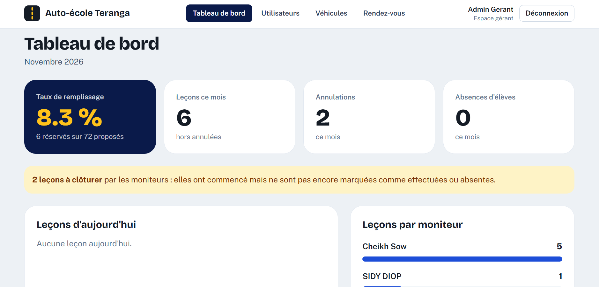
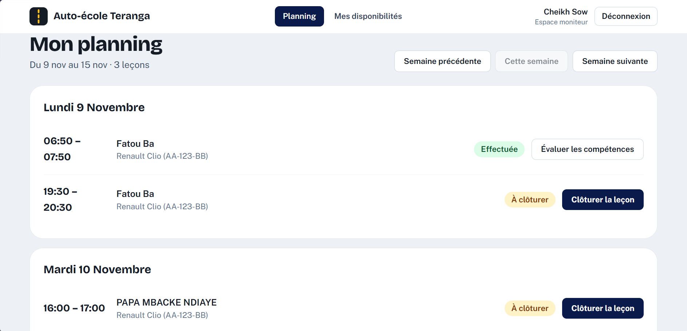
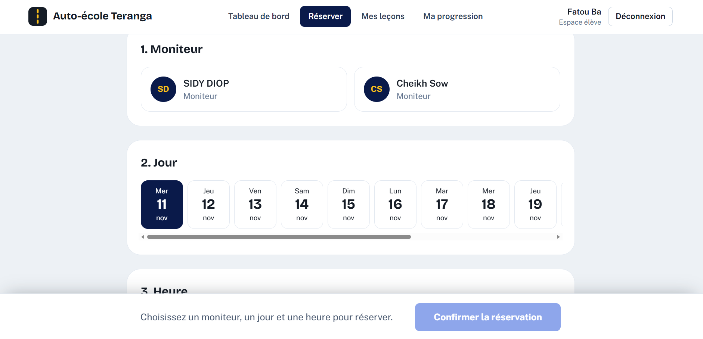
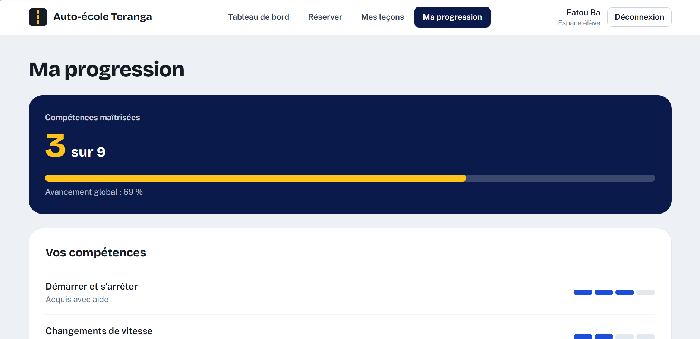
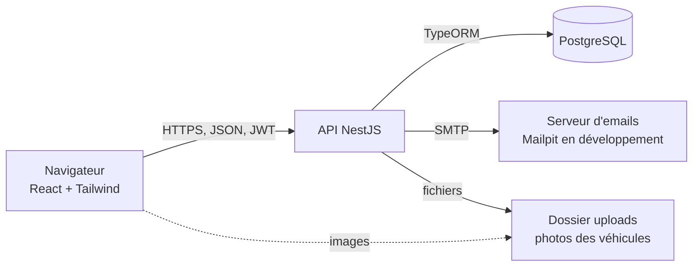
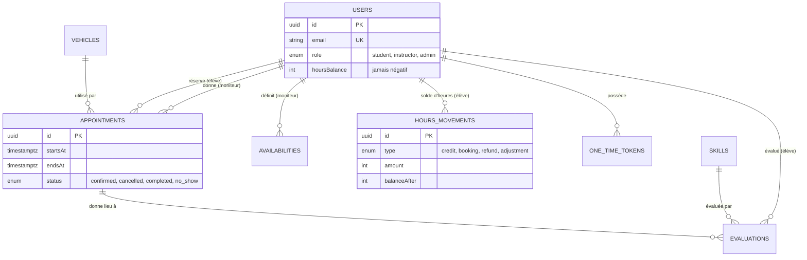
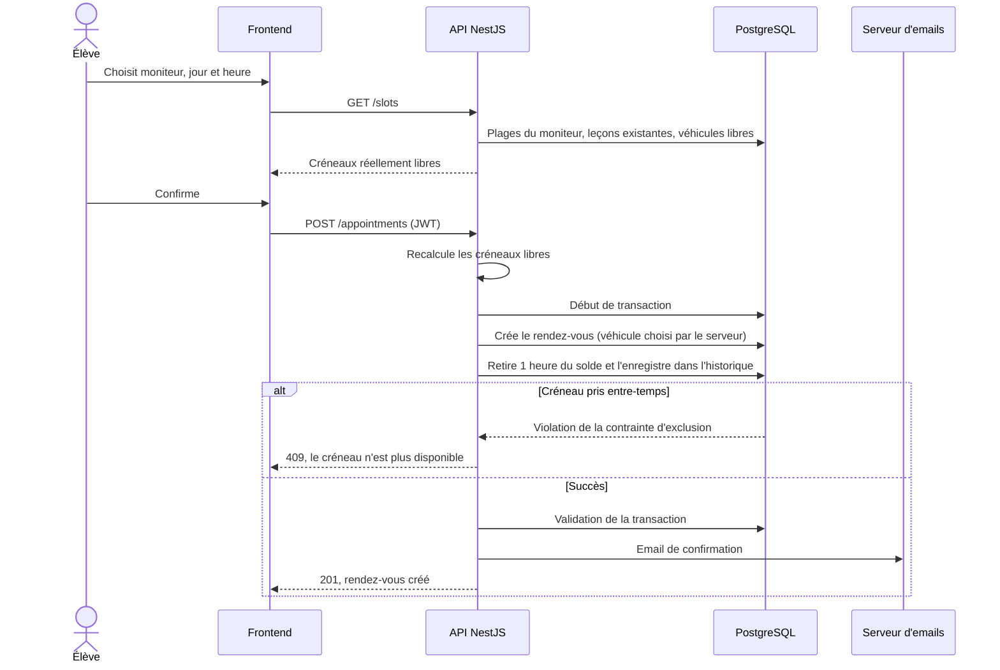

# Plateforme de réservation pour auto-école

Application web de prise de rendez-vous pour une auto-école. Les **élèves** réservent leurs leçons de conduite en ligne, les **moniteurs** gèrent leur planning et suivent la progression de leurs élèves, le **gérant** pilote l'ensemble (comptes, heures, véhicules, rendez-vous, statistiques).

Le point central du projet : **un moniteur et un véhicule ne peuvent jamais être réservés deux fois sur le même créneau**, même si deux élèves cliquent au même instant. Cette règle est garantie par PostgreSQL lui-même, pas seulement par le code.

## Aperçu

| ACCUEUIL DU SITE | 
|---|---|
|  |

| TABLEAU DE BORD DU GERANT | ESPACE MONITEUR |
|---|---|
|  |  |

| LES RESERVARIONS | LA PROGRESSION DE L'ELEVE |
|---|---|
|  |  |


## Sommaire

- [Fonctionnalités](#fonctionnalités)
- [Stack technique](#stack-technique)
- [Architecture](#architecture)
- [Règles métier](#règles-métier)
- [Sécurité](#sécurité)
- [Installation](#installation)
- [Tests](#tests)
- [Scénario de démonstration](#scénario-de-démonstration)
- [Choix techniques](#choix-techniques)
- [Limites et améliorations possibles](#limites-et-améliorations-possibles)

## Fonctionnalités

### Visiteur
- Page d'accueil animée : carrousel plein écran, aperçu interactif de la réservation, forfaits, avis
- Inscription avec **code de vérification à 6 chiffres envoyé par email**
- Connexion, mot de passe oublié (lien à usage unique)

### Élève
- Tableau de bord : solde d'heures, prochaine leçon, derniers mouvements
- **Réservation** : choix du moniteur, du jour et de l'heure parmi les créneaux réellement libres
- Mes leçons : à venir et passées, **annulation** avec rappel de la règle des 24 h
- Ma progression : niveau de chaque compétence (1 à 4) et observations des moniteurs

### Moniteur (invité par le gérant)
- Planning de la semaine, leçon par leçon
- **Clôture des leçons** (effectuée ou élève absent), observations, évaluation des compétences
- Gestion de ses disponibilités hebdomadaires

### Gérant
- Tableau de bord : taux de remplissage, leçons, annulations, absences, alerte « leçons à clôturer »
- Utilisateurs : invitation de moniteurs, **attribution d'heures** aux élèves, activation et désactivation de comptes
- Véhicules : ajout, modification, **photos**, blocage en cas de panne
- Rendez-vous : filtres (période, statut, moniteur) et annulation avec remboursement de l'heure

## Stack technique

| Couche | Technologies |
|---|---|
| Frontend | React, TypeScript, Vite, Tailwind CSS, React Router, Motion (animations) |
| Backend | NestJS, TypeORM, class-validator, Passport JWT, Nodemailer |
| Base de données | PostgreSQL 16 (migrations versionnées) |
| Environnement | Docker Compose (PostgreSQL + Mailpit, un faux serveur d'emails pour le développement) |
| Qualité | Tests end-to-end (Jest et Supertest) sur une base de test séparée |

## Architecture



Le backend est organisé en modules NestJS, un par domaine : `auth`, `users`, `tokens`, `vehicles`, `availability`, `appointments`, `hours`, `progress`, `mail`.

### Modèle de données



### Déroulé d'une réservation



## Règles métier

- Une leçon dure **1 heure**, sur les plages horaires du moniteur.
- Un créneau n'est proposé que si le moniteur **et** au moins un véhicule en service sont libres. Le serveur choisit lui-même le véhicule.
- Réserver **retire 1 heure** du solde. Le solde ne peut jamais être négatif (vérifié par le code **et** par une contrainte `CHECK` en base).
- **Annulation** par l'élève : plus de 24 h avant la leçon, l'heure est rendue ; en dessous, elle est perdue. Le gérant rembourse toujours.
- Une absence de l'élève ne rembourse pas l'heure.
- Seul le moniteur de la leçon (ou le gérant) peut la clôturer et l'évaluer.
- Les heures sont attribuées **par le gérant** (paiement à l'agence, pas de paiement en ligne). Chaque mouvement est historisé.

## Sécurité

| Sujet | Mesure |
|---|---|
| Mots de passe | Hachés avec bcrypt, jamais renvoyés par l'API |
| Authentification | JWT : access token de 15 minutes, refresh token de 7 jours **avec rotation** ; la déconnexion invalide réellement le refresh token |
| Rôles | Contrôlés **dans le backend** (guards), jamais seulement dans l'interface ; contrôle de propriété sur chaque ressource |
| Élévation de privilèges | Le rôle n'est jamais fourni par le client ; les rôles moniteur et gérant ne s'obtiennent que par invitation ou par script |
| Codes et liens | Code de vérification et liens de réinitialisation **hachés en base**, à durée courte, à usage unique, avec limite de tentatives |
| Énumération de comptes | Réponses identiques que l'email existe ou non |
| Double réservation | Contraintes d'exclusion PostgreSQL (`btree_gist`) sur le moniteur et sur le véhicule |
| Concurrence | Transactions avec verrous de ligne (solde, annulations) |
| Validation | Toutes les entrées validées (`class-validator`), champs inconnus refusés |
| Abus | Limitation de débit globale et plus stricte sur les routes sensibles, en-têtes `helmet`, CORS restreint |
| Fichiers envoyés | Type détecté d'après le **contenu** du fichier (pas l'extension), taille limitée, nom généré par le serveur |
| Secrets | Variables d'environnement, jamais dans le code ni sur GitHub |

## Installation

### Prérequis

Node.js 20 ou plus, Git, Docker Desktop.

### 1. Récupérer le projet et lancer les services

```bash
git clone https://github.com/itsmeprincepapa/autoecole-rdv.git
cd autoecole-rdv
cp .env.example .env
docker compose up -d
```

PostgreSQL écoute sur le port 5432. Les emails de développement sont lisibles sur http://localhost:8025 (Mailpit).

### 2. Backend

```bash
cd backend
npm install
cp .env.example .env
```

Dans `backend/.env` :
- mets le même mot de passe de base de données que dans le `.env` de la racine ;
- génère deux secrets **différents** pour `JWT_ACCESS_SECRET` et `JWT_REFRESH_SECRET` :

```bash
node -e "console.log(require('crypto').randomBytes(48).toString('hex'))"
```

- choisis l'email et le mot de passe du premier gérant (`SEED_ADMIN_EMAIL`, `SEED_ADMIN_PASSWORD`).

Puis :

```bash
npm run migration:run   # crée les tables et les contraintes
npm run seed            # crée le premier compte gérant
npm run start:dev       # API sur http://localhost:3000
```

### 3. Frontend

```bash
cd frontend
npm install
cp .env.example .env
npm run dev             # application sur http://localhost:5173
```

Pour alléger des photos du carrousel d'accueil (placées dans `frontend/public/images`) : `npm run optimize-images`.

### Premiers pas

1. Connecte-toi avec le compte gérant créé par `npm run seed`.
2. **Véhicules** : ajoute au moins un véhicule.
3. **Utilisateurs** : invite un moniteur (le lien d'activation arrive dans Mailpit), puis crédite des heures à un élève une fois inscrit.
4. Le moniteur définit ses **disponibilités**, et les élèves peuvent réserver.

## Tests

Les tests tournent sur une base séparée (`autoecole_test`), jamais sur les vraies données.

```bash
# une seule fois : créer et migrer la base de test
docker exec -it autoecole_postgres psql -U autoecole -d autoecole_db -c "CREATE DATABASE autoecole_test;"
cd backend
set DB_NAME=autoecole_test   # Windows (CMD) ; sous Linux et macOS : export DB_NAME=autoecole_test
npm run migration:run

# lancer les tests (dans un nouveau terminal, sans DB_NAME défini)
npm run test:e2e
```

Les tests couvrent : inscription refusée avec un rôle glissé dans la requête, connexion refusée tant que l'email n'est pas vérifié, accès refusé selon le rôle, et **impossibilité de réserver deux fois le même créneau** (avec vérification du débit d'heure).

## Scénario de démonstration

Environ 5 minutes :

1. **Accueil** : carrousel, aperçu de réservation interactif.
2. **Gérant** : crée un véhicule avec sa photo, invite un moniteur.
3. **Moniteur** : active son compte avec le lien reçu, définit ses disponibilités.
4. **Gérant** : crédite 20 heures à un élève.
5. **Élève** : s'inscrit avec le code par email, réserve un créneau, voit son solde baisser et la leçon dans « Mes leçons ».
6. **Preuve anti-conflit** : un second élève tente le même créneau et est refusé.
7. **Moniteur** : clôture la leçon, note les compétences.
8. **Élève** : voit sa progression et les observations. Il annule une autre leçon : l'heure est rendue (plus de 24 h) ou perdue (moins de 24 h).
9. **Sécurité** : avec un compte élève, l'appel d'une route du gérant est refusé (403).

## Choix techniques

| Choix | Raison |
|---|---|
| PostgreSQL avec contraintes d'exclusion | Empêche le chevauchement au niveau de la base : fiable même si le code ou la concurrence posent problème |
| Transaction + verrous pour la réservation | Le rendez-vous et le débit d'heure réussissent ensemble ou pas du tout |
| Migrations plutôt que `synchronize` | Évolutions de la base versionnées et reproductibles, sans risque de perdre des données |
| Solde = colonne + historique des mouvements | Lecture rapide, et traçabilité de chaque heure (qui a fait quoi, quand) |
| Refresh token haché avec rotation | Déconnexion réelle, et vol de session limité dans le temps |
| Tokens à usage unique dans une table commune | Un seul mécanisme pour la réinitialisation du mot de passe et l'invitation des moniteurs |
| Heures stockées en UTC, affichées dans le fuseau de l'auto-école | Pas d'ambiguïté, un seul réglage (`SCHOOL_TIMEZONE`) |
| Emails envoyés après la transaction | Une panne du serveur d'emails n'annule pas une réservation valide |
| Mailpit en développement | Tester les emails sans en envoyer de vrais ; en production, seule la configuration SMTP change |

## Limites et améliorations possibles

- **Pas de paiement en ligne** : les heures sont créditées par le gérant après règlement en agence.
- **Jetons dans `localStorage`** : simple et suffisant ici ; des cookies `httpOnly` résisteraient mieux aux attaques XSS.
- **Photos sur le disque du serveur** : à remplacer par un stockage cloud (S3, Cloudinary) sur un hébergeur qui efface les fichiers à chaque déploiement.
- **Limitation de débit en mémoire** : à partager (Redis) si l'API tourne sur plusieurs instances.
- **Emails envoyés directement** : une file d'attente permettrait des réessais.
- **Leçons d'une heure fixe**, sans report de rendez-vous : le gérant annule, l'élève réserve de nouveau.
- **Pas de rappels automatiques** avant les leçons ni de liste d'attente.
- **Tests** : le backend est couvert par des tests de bout en bout ; le frontend n'a pas encore de tests automatisés.
